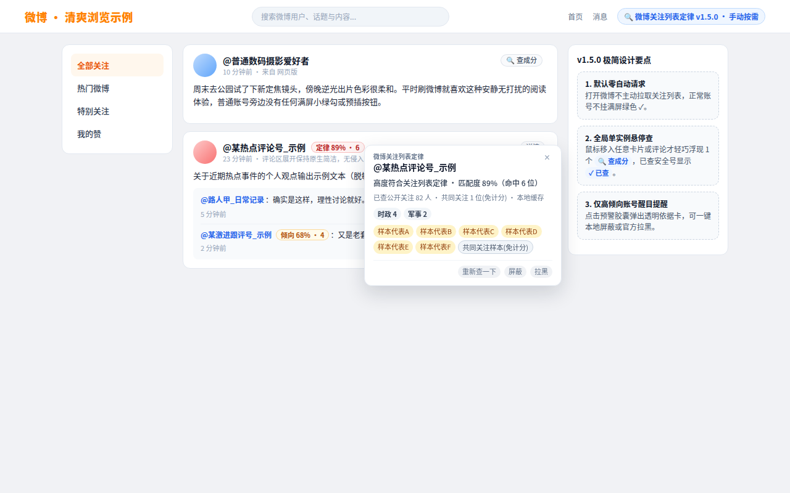
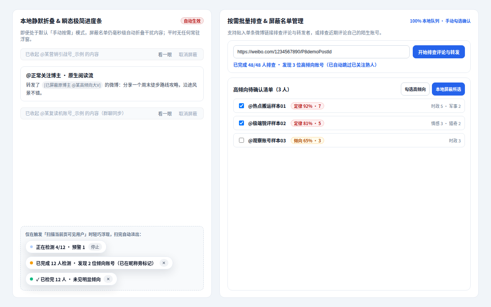
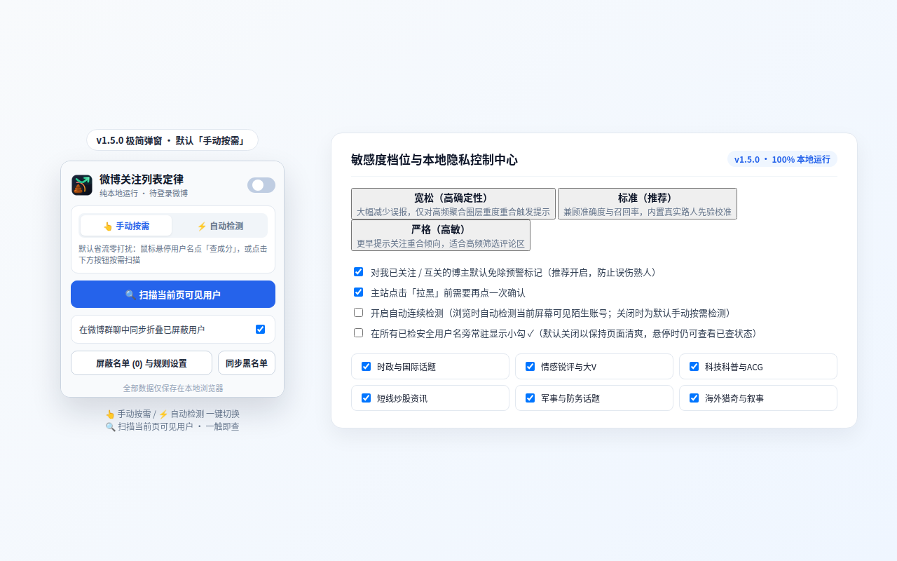

# 微博关注列表定律 (Weibo Follow Law)

[](https://developer.chrome.com/docs/extensions/mv3/)
[](#最小权限与隐私承诺)
[](LICENSE)

> 一款 **100% 本地运行、零远程服务器、零 `cookies` 权限** 的 Chrome MV3 扩展：基于「关注列表定律」提供按需式微博成分参考提示与本地一键折叠屏蔽降噪，专注于微博主站（`https://weibo.com`）清爽浏览。

---

## 为什么需要本项目？（背景起源）

「关注列表定律」概念源自微博博主 `@tombkeeper` 的长期观察与系统总结（涵盖归纳法与演绎法交互迭代、非对称污染模型、清粉与拉黑降噪等方法论，详见 2026-07-24 发布的合辑原帖：[《关注列表定律合辑》](https://weibo.com/1401527553/Ra8WyguDC)）。本扩展基于该思路，以工程化与统计学去偏方式实现为纯本地运行的浏览器辅助工具。

日常刷微博信息流与转发评论区时，经常会遇到高强度输出同质化情绪内容、令人不适的发言账号；而微博原生的黑名单或屏蔽机制存在一定局限（如他人转发引用、热门评论折叠区等场景仍会露出）。

本扩展遵循「**按需克制、本地隐私、绝不误伤**」的原则：
- **日常零打扰**：默认采用 **手工按需模式**，浏览微博时 **0 自动接口请求**、**0 满屏绿勾**、**0 常驻浮窗**；
- **想查才查，一触即得**：悬停用户名/转发链 `//@用户:`、打开微博官方悬停个人名片浮卡（UserCard）、或点击扩展弹窗扫描当前屏幕，即可在本地快速查看关注倾向分布；
- **主站全场景本地降噪**：已加入本地屏蔽列表或微博黑名单的账号，在首页信息流、转发链与评论区中可自动温和折叠或彻底隐藏，也可随时点开临时查看。

---

## 功能截图预览

| 主站按需查成分与官方名片/详情浮窗 | 批量排查与本地黑名单管理 | 弹窗控制与偏好规则设置 |
| :---: | :---: | :---: |
|  |  |  |

---

## 核心工作原理与防误伤机制（数学/特征权重模型）

为了避免“仅仅关注了一两位热门大众博主就被误标”的简单硬匹配问题，同时克服高关注账号命中多个高纯度核心特征被冲淡的漏检问题，扩展在本地内置了 **去热门校准、非对称阻尼与饱和封顶加权引擎**（当前内置 **85 组特征实体 / 93 个锚定 UID**，源码见 [`shared/radar_engine.js`](shared/radar_engine.js)）：

1. **单人权重远低于预警阈值（不会误伤）**
   - 每个参考特征账号根据领域特征与大众流行度赋予独立权重 $w_i$（区间 `0.15 ~ 1.28`），并对高粉丝大众/热门博主做去热门降权处理；
   - 标准档预警阈值设定为：**轻度提醒 `3.1` 分**、**高度匹配 `4.7` 分**。**单个博主最高权重 `1.28` 远低于预警阈值**，仅关注一两位泛圈层或热门博主绝不会触发预警提醒。
2. **多圈层饱和封顶与非对称高关注阻尼**
   - 同一细分领域的命中累计设置边际递减，短线炒股板块施加硬封顶（`≤ 0.70`），泛话题层整体施加对数凹函数饱和压缩，防止单一热门话题关注被线性放大；
   - **非对称总关注数阻尼**：总关注数对数阻尼分母 $\text{denom}$ 仅衰减泛话题与炒股层（$\text{score} = S_{\text{core}} + S_{\text{pan,eff}} / \text{denom}$），不再稀释高纯度核心锚点（$w_i \ge 0.85$），兼顾对高关注路人的防误伤与对高关注目标账号的检出率；
   - 当存在跨多个不同圈层的较高权重参考账号同时共现时，才会超过预警线并展示具体命中明细与领域分布。
3. **多重自动豁免与共同关注分层收敛**
   - **当前登录账号本人豁免**：本人主页与本人卡片默认免预警（同时提供「模拟访客自测」按钮，方便用户自查真实访客视角得分，且不污染本地缓存）；
   - **已关注 / 互关账号豁免**：默认对您主动关注的博主免予打标；
   - **官方蓝V机构号豁免**：媒体、政务、机构蓝V认证号默认跳过；
   - **共同关注分层处理**：对方关注的泛话题（$w_i < 0.85$）及炒股博主若您本人也关注了，默认标记为「共同免计」且不计分；高纯度核心锚点（$w_i \ge 0.85$ 且非炒股）默认保留计分并醒目标注「您也关注」，用户亦可在「偏好与规则」中按需开启「严格同圈豁免」改为全量免计分。

> **完整数学模型与校准参考**：想了解特征名单是如何从匿名对比样本中筛选、如何做公共/大众号去偏，以及单博主权重 $w_i$ 与饱和阻尼公式的完整推导，请参阅 [**特征名单与权重计算方法论 (`docs/METHODOLOGY.md`)**](docs/METHODOLOGY.md)；配套零依赖通用校准与演示脚本见 [**`scripts/calc_weights.py`**](scripts/calc_weights.py)（可直接运行 `python3 scripts/calc_weights.py --demo`）。

---

## 最小权限与隐私承诺

本扩展严格坚持 **100% 本地运行 + 最小权限原则**：

| 申请项 | 实际内容 | 说明 |
| --- | --- | --- |
| `permissions` | `["storage"]` | **仅申请 `storage` 单一权限**；**彻底移除 `cookies` 权限**，不调用任何 `chrome.cookies` 接口 |
| `host_permissions` | `https://weibo.com/*` | 仅限微博主站单一官方同源域；仅在用户主动点击查成分、批量扫描或屏蔽操作时触发同源请求 |
| 数据存储 | `chrome.storage.local` + `IndexedDB` | 个人偏好、本地屏蔽列表与 7 天临时查重缓存全部存储在本地浏览器，卸载即彻底清除 |
| 远程服务器 / SDK | **无** | 零后端服务器、零统计埋点、零广告或追踪脚本 |

详细中英文隐私条款请见：[**PRIVACY.md**](PRIVACY.md) ｜ 安全策略见：[**SECURITY.md**](SECURITY.md)。

---

## 本地安装与源码运行（开发者模式）

1. 克隆本仓库或从 Releases 下载源码包：
   ```bash
   git clone https://github.com/valid-studio/weibo-follow-law.git
   ```
2. 在 Chrome 浏览器地址栏打开 `chrome://extensions/`。
3. 开启右上角 **开发者模式（Developer mode）**。
4. 点击 **加载已解压的扩展程序（Load unpacked）**，直接选择仓库根目录（即包含 `manifest.json` 的目录）。
5. 打开或刷新 `https://weibo.com` 即可使用（工具栏图标永久保持零角标，不打扰日常浏览）。

---

## 常见问题 FAQ

**Q1：为什么打开微博后什么反应都没有？是不是没生效？**
- 自 `v1.5.0` 起默认采用 **「手动按需」模式**（零自动后台请求）。只需将鼠标悬停在微博昵称、`//@用户:` 转发链上（会出现轻巧的「查成分」按钮），或鼠标移到用户头像/昵称弹出微博官方名片浮卡（底部操作栏旁会出现「查成分」按钮），或点击浏览器右上角插件图标选择 **「扫描当前页可见用户」** 即可立即使用。

**Q2：为什么看自己的主页显示「本人免预警」，怎么测自己的真实得分？**
- 系统默认对当前登录账号免除预警。在本人主页横幅或本人名片浮窗内，点击 **「模拟访客自测（查看真实得分）」**，即可在不写入缓存、不隐藏拉黑按钮的前提下查看其他访客视角下的真实命中结果。

**Q3：遇到“对方设置了仅关注可见 / 隐藏关注列表”怎么办？**
- 微博官方支持用户将关注列表设为仅自己或关注者可见，扩展尊重平台官方隐私限制，绝不绕过或爬取受限隐私接口，会在浮窗中明确提示“对方已隐藏关注列表”。

**Q4：如何反馈误判或自定义排除/屏蔽规则？**
- 可在插件「管理与批量排查 → 偏好与规则」标签页随时调整敏感度档位（宽松 / 标准 / 严格）、6 大领域开关、自定义跳过白名单与本地屏蔽名单导入导出；也欢迎通过 [GitHub Issues](https://github.com/valid-studio/weibo-follow-law/issues) 提交改进建议。

---

## 开源许可

本项目基于 [MIT License](LICENSE) 开源。
